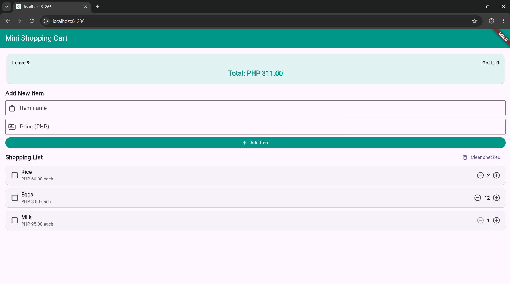

# stateful_lab_fabroa

# Laboratory Activity 3: Mini Shopping Cart with StatefulWidget

Student Name: Christine Jade Fabroa

## Description

This Flutter application demonstrates the use of `StatefulWidget` and `StatelessWidget` to build a mini shopping cart. It allows users to add items, change item quantities, mark items as purchased, and remove checked items.

## Features

- Displays three initial shopping items: Rice, Eggs, and Milk.
- Increases and decreases item quantities, with a minimum of 1 and a maximum of 99.
- Displays the total number of items, checked items, and cart cost.
- Validates item names and prices before adding items.
- Removes all checked items using the Clear checked button.
- Uses `setState()` to update the interface when cart data changes.

## Screenshot

